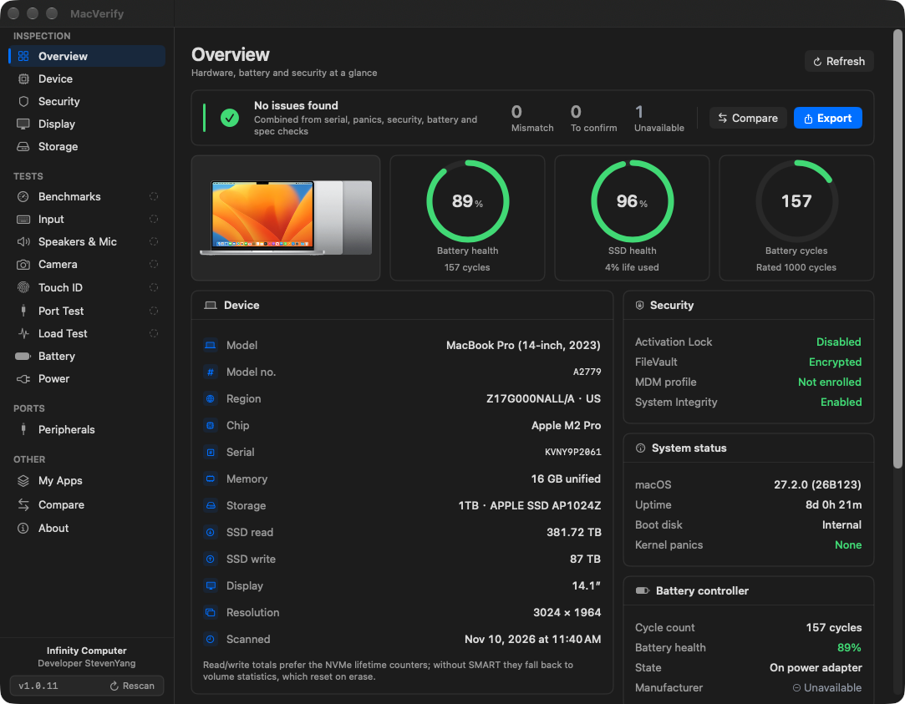
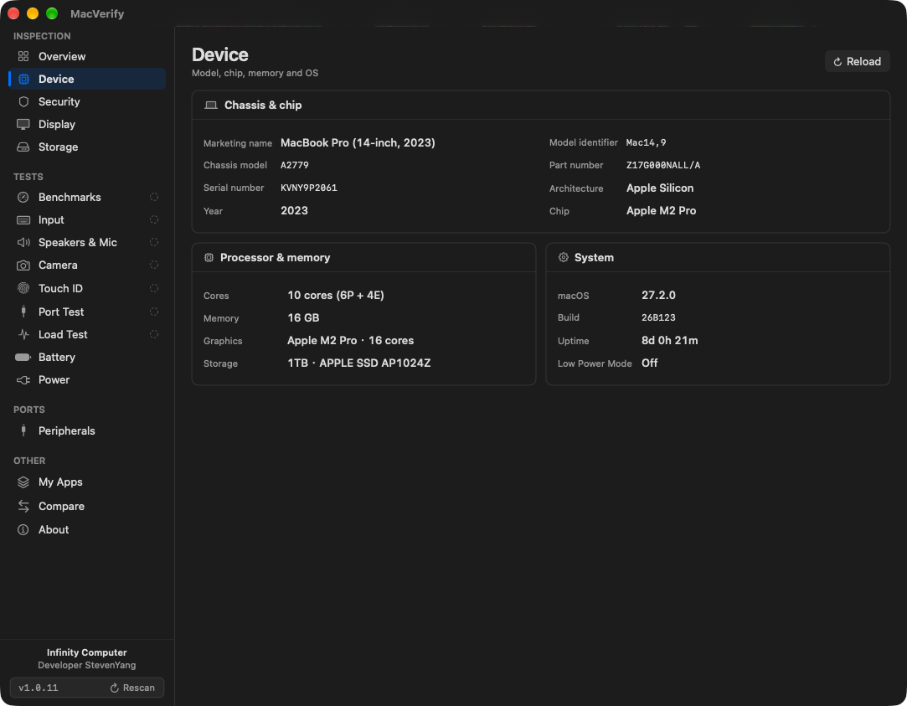
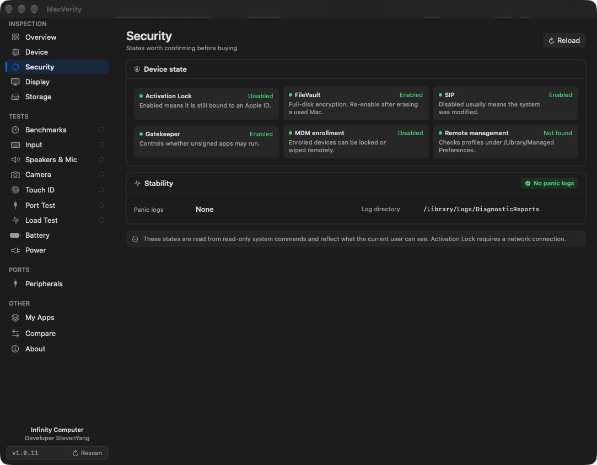
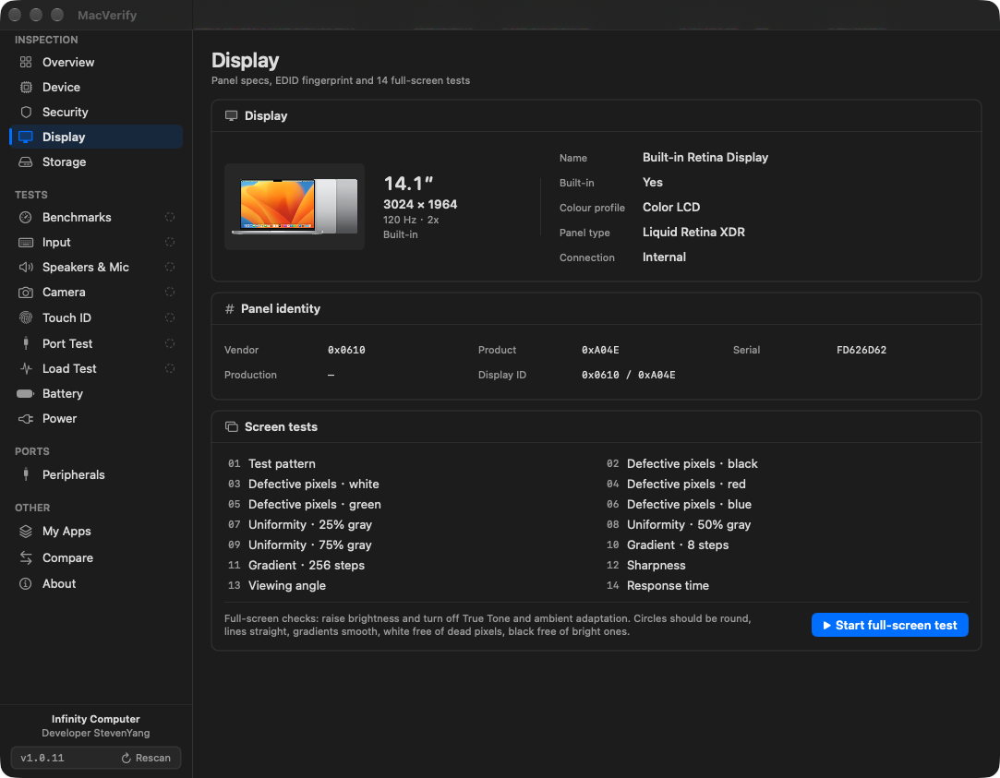
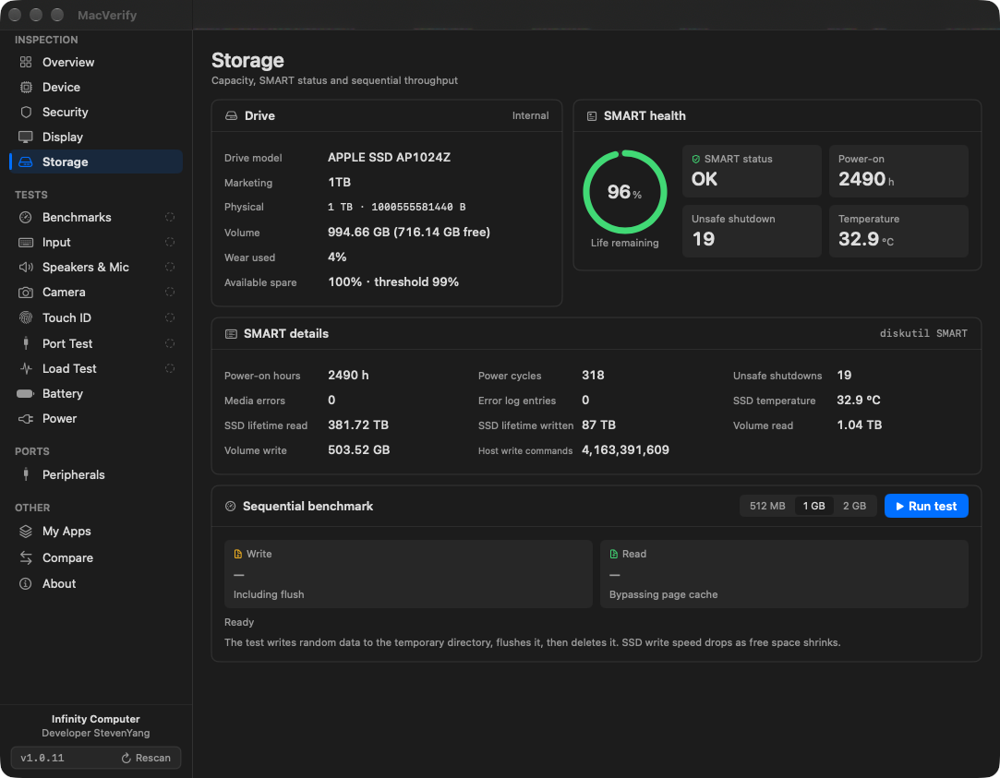
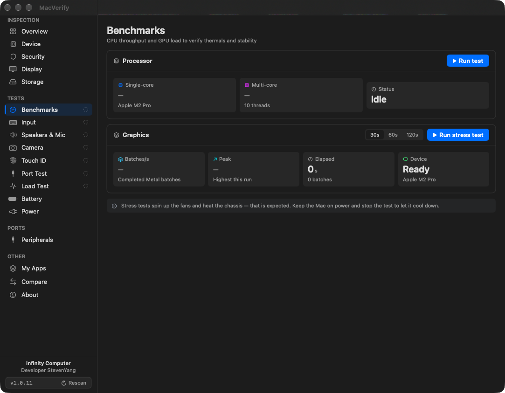
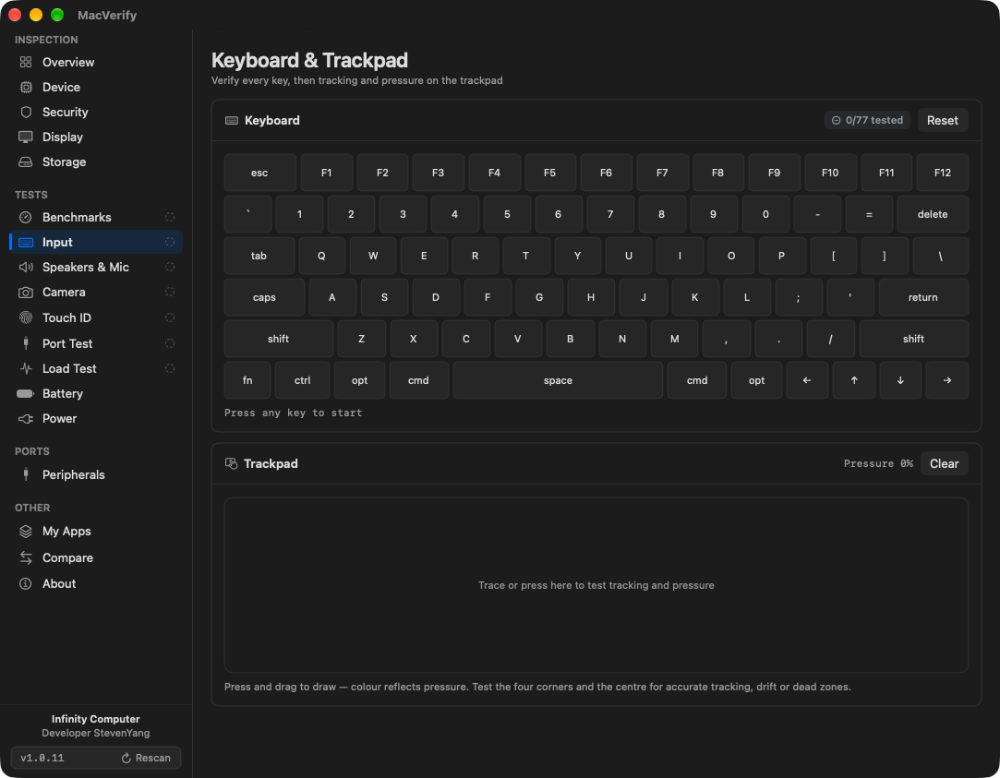
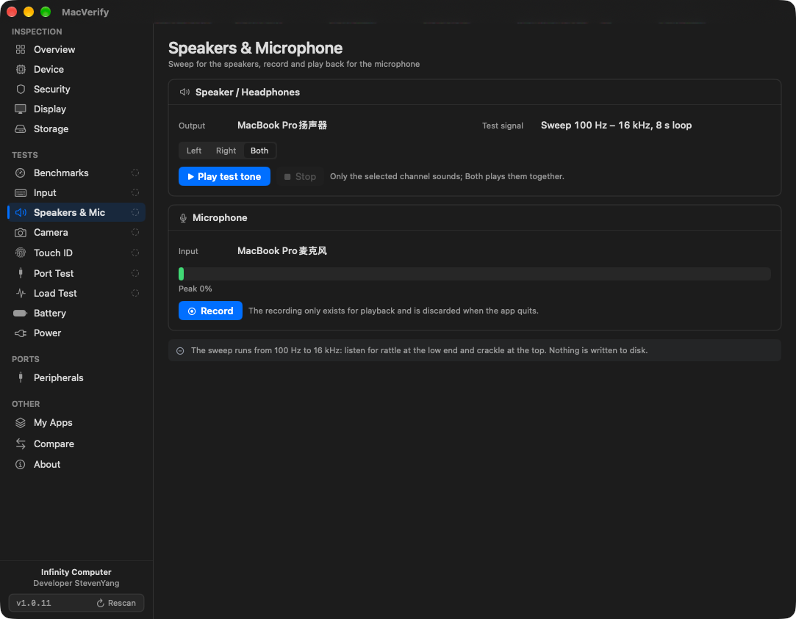
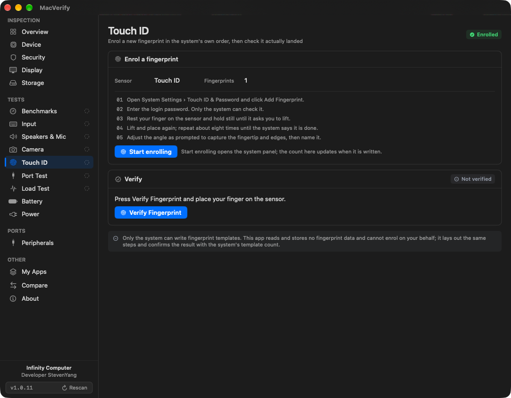

# MacVerify

**Hardware inspection for used Macs — every number comes from this machine.**

[**简体中文**](README.zh-CN.md) · macOS 12 Monterey or later · Universal binary (Intel & Apple Silicon) · English / 简体中文



MacVerify reads what macOS exposes through IOKit, sysctl, CoreGraphics and a handful of read-only system commands, then
states a verdict only where the evidence supports one. If a sensor, a panel or an identifier is not exposed, it says so:
never guessed, never interpolated, never replaced with a zero.

## Why it holds up

| Practice | What it means |
| --- | --- |
| **Two independent sources** | Model, serial, chip, disk size, built-in panel and memory are each read through two separate paths. A mismatch is reported — the only reliable way to spot a re-labelled model or a rewritten serial. |
| **Missing stays missing** | Unreadable values render as `null` / “Unavailable”; things that genuinely do not exist (no USB device, no battery) get a different marker. The two are never blended. |
| **No hard-coded guesses** | The model table only carries Apple's own identifiers; chip names are not baked into model names. Spec baselines cover only the Apple tech-spec pages that were actually checked. |
| **Reviewable output** | Reports export as Markdown + JSON with `null` for missing values, so two inspections of the same machine can be diffed field by field. |

## Features

| Area | What it shows |
| --- | --- |
| Overview | Model, sales region from the part-number suffix, chip, memory, storage, battery health, activation lock, FileVault, MDM, panic logs |
| Consistency | Model / serial / chip / disk size / built-in panel / memory compared across two sources |
| Originality | Checks against Apple tech specs: panel, memory and storage tiers, GPU core count, battery capacity and internal coherence |
| Device | Architecture, core layout (Intel cores/threads, Apple Silicon performance + efficiency), every GPU including Intel's discrete chips |
| Security | Activation lock, FileVault, SIP, Gatekeeper, MDM, remote management, kernel panics (including `.ips`) |
| Display | Native resolution, refresh rate, panel identity, and 14 full-screen tests (defective pixels, uniformity, gradients, sharpness, viewing angle, response time) |
| Storage | Drive model, physical capacity, full NVMe SMART (life used, spare blocks, power-on hours, unsafe shutdowns, temperature, data written), measured read/write |
| Benchmarks | CPU single- and multi-core throughput, sustained Metal load measured in real batches per second |
| Input | Every key lit up with coverage count, left/right modifier distinction, trackpad strokes and pressure |
| Speakers & Mic | 100 Hz–16 kHz sweep, left / right / both channels; microphone RMS level, recording and playback |
| Camera | Live capture session and resolution; records `.mov` to the Desktop and plays it back in the app |
| Touch ID | Enrols a fingerprint in the system's own order while watching the real template count, then runs one real authentication |
| Port Test | Device inserted per port, IOKit diffed once a second for attach/detach and USB link speed |
| Battery | Capacity, health (same definition as System Settings), cycles, voltage and current, internal-resistance estimate |
| Load Test | Real discharge sampling: capacity consistency, voltage sag, temperature rise — results kept for comparison |
| Power | Adapter wattage, charging state, live power draw, time remaining |
| Peripherals | Attached devices and their transport details |
| Compare | Any two saved inspections diffed field by field |
| My Apps | Links to the author's other releases |

## Screenshots

<table>
  <tr>
    <td width="50%"><br>
      <sub><b>Device</b> — cores, threads, every GPU, memory and storage in one place</sub></td>
    <td width="50%"><br>
      <sub><b>Security</b> — activation lock, FileVault, SIP, Gatekeeper, MDM, remote management</sub></td>
  </tr>
  <tr>
    <td><br>
      <sub><b>Display</b> — panel identity and 14 full-screen checks</sub></td>
    <td><br>
      <sub><b>Storage</b> — the full NVMe SMART set, not just “healthy”</sub></td>
  </tr>
  <tr>
    <td><br>
      <sub><b>Benchmarks</b> — CPU and sustained Metal load, repeated runs compared</sub></td>
    <td><br>
      <sub><b>Input</b> — per-key coverage on a real keyboard map</sub></td>
  </tr>
  <tr>
    <td><br>
      <sub><b>Speakers &amp; Mic</b> — channel sweep, level meter, record and play back</sub></td>
    <td><br>
      <sub><b>Touch ID</b> — enrolment steps with live template count, then a real authentication</sub></td>
  </tr>
</table>

## Requirements

- macOS 12.0 Monterey or later; Intel and Apple Silicon both supported
- No sandbox, no background agent, no kernel extension, no privileged helper

## Install

1. Download the latest `.dmg` from [Releases](https://github.com/stevenjx/MacVerify/releases)
2. Drag `MacVerify.app` into Applications
3. If macOS says the developer cannot be verified: right-click → Open (or
   `xattr -dr com.apple.quarantine /Applications/MacVerify.app`)

The app is ad-hoc signed and not notarised by Apple.

## Updates

The app asks GitHub for the latest release once per launch, at most every six hours. When a newer version exists the
version number in the sidebar turns amber and a second line appears; clicking it downloads the official DMG into your
Downloads folder and reveals it in Finder. Nothing is installed automatically and no existing file is overwritten.

## Data sources

`IOKit` (AppleSmartBattery, IOPlatformExpertDevice, NVMe SMART, IOMedia), `sysctl`, `CoreGraphics`, and the read-only
commands `system_profiler` / `diskutil` / `fdesetup` / `csrutil` / `spctl` / `profiles` / `bioutil`.
Every command is parsed as `-json` / `-plist`, so the system language never changes the result.

## Known limitations

- **Sensors** — most Apple Silicon Macs do not expose battery temperature or SMC voltages to user space. Shown as
  unavailable rather than estimated.
- **SMART** — internal SSDs report the full NVMe set; external drives depend on whether the bridge chip forwards it.
- **Battery capacity cross-check** — Apple publishes Wh while the battery reports mAh; the conversion needs the rated
  voltage, and when the machine does not provide it no verdict is given.
- **Model and spec baselines** — only Apple identifiers and checked spec pages are included; anything else reads
  “not in the table” rather than a guess.
- **Activation lock** — state comes from the system and may be unreadable while offline.

## Build from source

```bash
DEVELOPER_DIR=/Applications/Xcode.app/Contents/Developer xcodebuild \
  -project MacVerify.xcodeproj -scheme MacVerify -configuration Release \
  -destination 'generic/platform=macOS' -derivedDataPath build \
  ARCHS="arm64 x86_64" ONLY_ACTIVE_ARCH=NO CODE_SIGNING_ALLOWED=NO build
```

Automation hooks used by the test suite and for verification:

- `MACVERIFY_PAGE=<overview|hardware|security|display|storage|performance|input|audio|camera|touchID|ports|loadTest|battery|power|peripherals|apps|comparison|about>`
  opens a page directly
- `MACVERIFY_DUMP_REPORT=/tmp/report.md` collects one inspection, writes Markdown + JSON, then exits
- `MACVERIFY_PANEL_TEST=<0-13>` jumps into the full-screen display test and stops on step N (`14` = completion page)

## Release flow

1. Changes are committed and pushed; **no release is created at this point**
2. A testable app is built locally: `Scripts/build_local_app.sh` → `dist/local/MacVerify.app`
3. A DMG is produced only once a GitHub release exists: CI listens for `release: published`, builds the universal
   binary, verifies tag and version agree, and uploads the DMG as an asset of that release
4. Local archive: `Scripts/make_dmg.sh` (exits early if the version has not been released)

The version lives in two places in `project.pbxproj`: `MARKETING_VERSION` and `CURRENT_PROJECT_VERSION`.

## Privacy

Inspection runs entirely offline and never uploads anything about the machine; no system setting is modified. The only
outbound request is the release check, which reads public metadata and sends no identifiers. Recordings stay local:
audio goes to a temporary directory and is deleted on exit; video is written to the Desktop only when you press record.
Inspection results are stored in this Mac's `UserDefaults`.

## Development

```bash
swift test --disable-sandbox          # 109 unit tests
python3 Scripts/check_baseline.py     # model table and spec baselines
python3 Scripts/check_localization.py # missing-translation lint
```

Planning notes live in [docs/DEVELOPMENT_PLAN.md](docs/DEVELOPMENT_PLAN.md); the UI rework is recorded in
[docs/UI_PLAN.md](docs/UI_PLAN.md).
