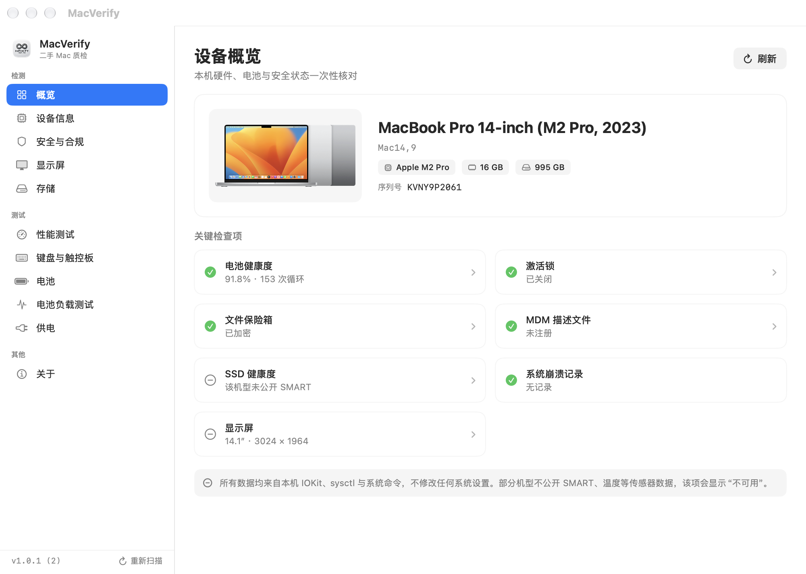

# MacVerify

二手 MacBook 硬件质检工具 · 面向 macOS 12 Monterey 及以上 · 通用二进制（Intel / Apple Silicon）

Hardware inspection for used MacBooks. macOS 12+ · Universal binary (Intel & Apple Silicon).



---

## 功能 / Features

| 模块 | 检查内容 |
| --- | --- |
| 概览 | 机型、芯片、内存、容量、电池健康、激活锁、FileVault、MDM、崩溃记录一站式汇总 |
| 设备信息 | 机型标识、营销名称、机型编号、序列号、核心构成、系统版本 |
| 安全与合规 | 激活锁、FileVault、SIP、Gatekeeper、MDM 注册、远程管理描述文件、内核崩溃统计 |
| 显示屏 | 原生分辨率、刷新率、缩放倍率、EDID 厂商/序列号/生产批次、纯色检查（黑 / 5% 灰 / 10% 灰 / RGB）|
| 存储 | 磁盘型号、SMART 寿命、累计读写字节、顺序读写实测（8 MB 块 + F_FULLFSYNC 落盘）|
| 性能测试 | CPU 单核/多核吞吐、Metal 计算管线持续负载（真实批次/秒）|
| 键盘与触控板 | 逐键触发与覆盖统计、修饰键左右区分、触控板定位与压力轨迹 |
| 电池 | 设计容量、满充容量、健康度、循环、电压电流、内阻估算（ΔV/ΔI）|
| 电池负载测试 | 真实放电采样，给出容量一致性、压降、温升判定并保存历史 |
| 供电 | 适配器功率、充电状态、实时功率、剩余时间 |

界面支持 **跟随系统 / 简体中文 / English**，以及 **跟随系统 / 浅色 / 深色**，切换即时生效。

## 数据来源与真实性 / Data sources

所有数值均来自本机只读接口，**不做估算填充**：

- `IOKit`：`AppleSmartBattery`、`IOPlatformExpertDevice`、`IOBlockStorageDriver`、`NVMe SMART`、`IODisplayConnect`
- `sysctl` / `ProcessInfo`：芯片、核心、内存、系统版本、低电量模式
- `CoreGraphics` / `AppKit`：显示器尺寸、原生分辨率、刷新率、色彩配置
- 只读系统命令：`system_profiler`、`fdesetup`、`csrutil`、`spctl`、`profiles`、`diskutil`

当机型不向用户态暴露某项数据（Apple Silicon 上常见：SMART、电池温度、EDID）时，界面显示「不可用」，不会伪造数值。

## 系统要求 / Requirements

- macOS 12.0 Monterey 或更高（已在 macOS 27 上验证）
- Intel 与 Apple Silicon 均可（Release 为 x86_64 + arm64 通用二进制）
- 无沙盒、无后台常驻、无内核扩展、无特权 helper

## 安装 / Install

1. 下载 `MacVerify-1.0.1.dmg`
2. 打开后将 `MacVerify.app` 拖入「应用程序」
3. 首次打开如提示“无法验证开发者”，右键点击应用 → 打开（或执行 `xattr -dr com.apple.quarantine /Applications/MacVerify.app`）

应用为本地 ad-hoc 签名，未做 Apple 公证。

## 从源码构建 / Build

```bash
# 通用二进制
xcodebuild -project "MacVerify.xcodeproj" -scheme MacVerify \
  -configuration Release -destination 'generic/platform=macOS' \
  -derivedDataPath build build

open build/Build/Products/Release/MacVerify.app
```

命令行入口 `MACVERIFY_PAGE=<overview|hardware|security|display|storage|performance|input|battery|loadTest|power|about>` 可直接打开指定页面，便于排查问题。

## 隐私 / Privacy

不联网、不上传、不写入系统设置。测试数据仅保存在本机 `UserDefaults`。

## 已知限制 / Limitations

- **SMART 与电池温度**：Apple Silicon 机型通常不向第三方公开，显示为「不可用」。
- **EDID**：部分 Apple 机型不提供，无法据此判断面板更换。
- **激活锁**：状态由系统在联网后返回；离线时可能读不到。
- **充电上限**：macOS 在系统设置中管理，第三方应用无法安全改写，本工具只读取状态。
- **压降与内阻**：必须在电池供电、真实放电时才有效；接电源时该项会被排除。

## Changelog

### 1.0.1
- 应用更名为 **MacVerify**（原 MacCheck），Xcode 工程、目标、源码目录同步改名
- Bundle 标识更新为 `com.steven.MacVerify`
- 界面标题、窗口标题与设置项统一使用 MacVerify

### 1.0.0
- 重写全部数据采集逻辑，移除了旧版本中由哈希/随机数生成的读写量、温度、FPS、容量与评分
- 移除无效的 `pmset BATT_CHG_LIM` 充电阈值命令与伪造的 SMC 校准流程
- 部署目标降至 macOS 12，自绘侧边栏与图表，去除 `NavigationSplitView` / `Charts` / `Grid` 等 13+ API
- 新增跟随系统/中文/英文三态语言，全部文案双语化并精简
- 更新机型表（Intel MacBook Air/Pro 2012–2020，Apple Silicon M1–M4）
- 修复磁盘统计键名错误、根磁盘解析错误、键盘键码重复、全屏窗口未定位到主屏等问题
