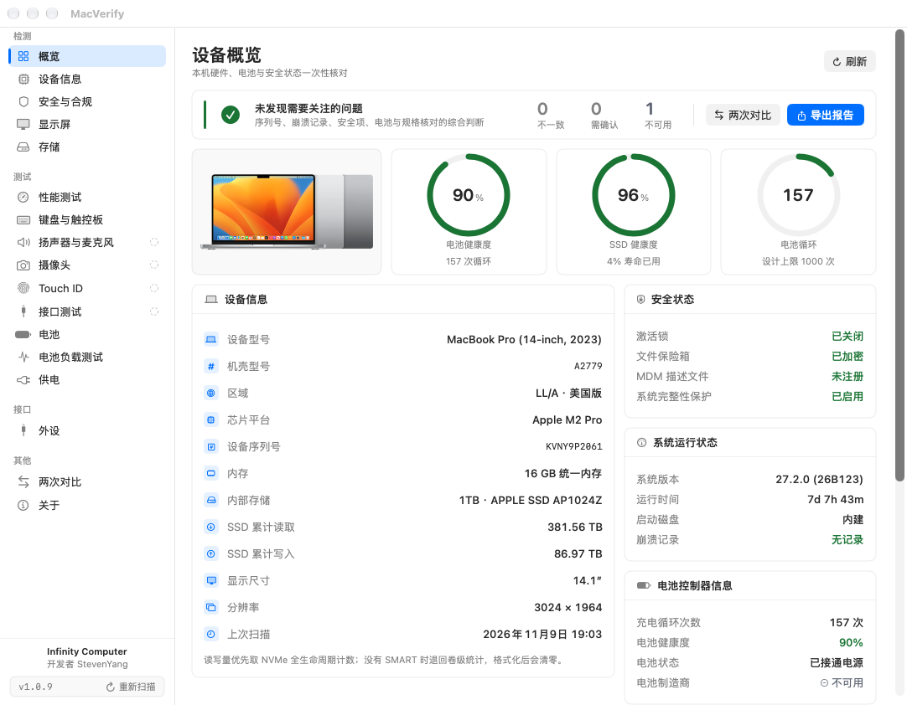

# MacVerify

**Hardware inspection for used MacBooks.** Every value comes from this Mac's own read-only interfaces.
When a sensor or identifier is not exposed, MacVerify says so — it never guesses, interpolates, or fills in a default.

**二手 MacBook 硬件质检工具。** 所有数值均来自本机只读接口。当某项数据本机不对外暴露时，
界面如实显示「不可用」，不做估算、不做补值、不用 0 或 false 冒充。

macOS 12 Monterey+ · Universal binary (Intel & Apple Silicon) · 中英双语 · 不联网



---

## 为什么可信 / Why it can be trusted

二手验机最容易出问题的地方不是"读不到"，而是"读错了还看不出来"。MacVerify 对每一类结论都给出可复核的依据。

Used-Mac checks usually fail not by returning nothing, but by returning something plausible and wrong.
MacVerify makes the evidence behind every claim inspectable.

| 做法 | 说明 |
| --- | --- |
| **缺失即不可用** | 取不到数据时输出 `null` / 「不可用」。例如崩溃日志目录无权限时显示「无法读取」，而不是「无崩溃记录」 |
| **双通路互证** | 机型、序列号、芯片、磁盘容量、内建屏、内存各自从两条独立通路读取并比对，不一致即报告。用于识别改机型、刷序列号、换屏、换盘 |
| **统一口径** | 电池健康度采用 `AppleRawMaxCapacity ÷ DesignCapacity`，与「系统设置 → 电池」显示的数字一致 |
| **不写死易错数据** | 机型表只收录 Apple 官方标识符，不把芯片写进机型名（同一标识符常对应多个芯片），未收录机型显示「未收录」而非猜测 |
| **可导出复核** | 质检报告导出为 Markdown + JSON，每次检测都可留证、可比对 |

## 功能 / Features

| 模块 | 检查内容 |
| --- | --- |
| 概览 | 机型、**销售区域**、芯片、内存、容量、电池健康、激活锁、FileVault、MDM、崩溃记录一站式汇总 |
| 一致性核验 | 机型 / 序列号 / 芯片 / 磁盘容量 / 内建屏 / 内存各自双通路比对 |
| 原装性核对 | 内建屏分辨率与对角线、内存与存储档位、GPU 核心数、电池容量，对照 Apple 官方技术规格（仅限已收录机型，未收录显示「无对照数据」）|
| 设备信息 | 机型标识、营销名称、机壳型号、配置编号、序列号、核心构成、GPU 核心数、系统版本 |
| 安全与合规 | 激活锁、FileVault、SIP、Gatekeeper、MDM 注册、远程管理描述文件、内核崩溃统计（含 `.ips`）|
| 显示屏 | 原生分辨率、刷新率、缩放倍率、面板厂商/型号/序列号/类型（Apple Silicon 亦可读）、纯色检查 |
| 存储 | 磁盘型号、标称与物理容量、**SMART 全字段**（寿命消耗、备用块、上电时长、通电次数、异常断电、介质错误、温度、生命周期累计读写）、顺序读写实测 |
| 性能测试 | CPU 单核/多核吞吐、Metal 计算管线持续负载（真实批次/秒）|
| 键盘与触控板 | 逐键触发与覆盖统计、修饰键左右区分、caps lock 触发、触控板定位与压力轨迹 |
| 扬声器与麦克风 | 左右声道各播一次 440 Hz 正弦波（单侧静音）、麦克风实时 RMS 电平与峰值 |
| 摄像头 | 真实打开采集会话与预览，显示设备名与当前采集分辨率；不录制、不保存 |
| Touch ID | 硬件 / 指纹录入状态 + 真正调起一次生物识别认证，取消与失败如实区分 |
| 接口测试 | 逐口插入设备，IOKit 实时差分出接入/拔出事件与 USB 链路速率（含雷雳与外置存储）|
| 电池 | 设计容量、满充容量、健康度（与系统设置同口径）、循环、电压电流、内阻估算（ΔV/ΔI）|
| 电池负载测试 | 真实放电采样，给出容量一致性、电压下降（含电量分量）、温升判定并保存历史 |
| 供电 | 适配器功率、充电状态、实时功率、剩余时间 |
| 报告 | 导出 Markdown + JSON，缺失项输出 `null` / `unavailable` |

界面支持 **跟随系统 / 简体中文 / English**，以及 **跟随系统 / 浅色 / 深色**，切换即时生效。

## 数据来源 / Data sources

所有数值均来自本机只读接口，且命令行工具一律以 `-json` / `-plist` 解析，不受系统语言影响：

- `IOKit`：`AppleSmartBattery`、`IOPlatformExpertDevice`、`IOBlockStorageDriver`、`NVMe SMART`、`IODisplayConnect`
- `sysctl` / `ProcessInfo`：芯片、核心、内存、系统版本、低电量模式
- `CoreGraphics` / `AppKit`：显示器尺寸、原生分辨率、刷新率、色彩配置
- 只读系统命令：`system_profiler`、`fdesetup`、`csrutil`、`spctl`、`profiles`、`diskutil`

## 关键口径 / Definitions

- **电池健康度**：`AppleRawMaxCapacity ÷ DesignCapacity`，与 macOS「系统设置 → 电池」一致
  （实测：设计 6075 mAh、满充 5441 mAh → 89.6%，系统显示 90%）
- **存储容量**：取物理盘 `diskutil TotalSize` 并按零售规格归一（1000.6 GB → 1TB），与「根卷可用容量」分开显示
- **负载压降**：测试期间电量同步下降，端电压下降包含 SOC 分量，不等同于内阻
- **一致性核验**：同一事实双通路比对，不依赖外部规格表；未收录机型不做推断

## 系统要求 / Requirements

- macOS 12.0 Monterey 或更高
- Intel 与 Apple Silicon 均可（Release 为 x86_64 + arm64 通用二进制）
- 无沙盒、无后台常驻、无内核扩展、无特权 helper

## 安装 / Install

1. 下载 `MacVerify-1.1.0.dmg`
2. 打开后将 `MacVerify.app` 拖入「应用程序」
3. 首次打开如提示"无法验证开发者"，右键点击应用 → 打开
   （或执行 `xattr -dr com.apple.quarantine /Applications/MacVerify.app`）

应用为本地 ad-hoc 签名，未做 Apple 公证。

## 从源码构建 / Build

```bash
DEVELOPER_DIR=/Applications/Xcode.app/Contents/Developer xcodebuild \
  -project "MacVerify.xcodeproj" -scheme MacVerify \
  -configuration Release -destination 'generic/platform=macOS' \
  ARCHS="arm64 x86_64" ONLY_ACTIVE_ARCH=NO \
  -derivedDataPath build build
```

命令行入口：

- `MACVERIFY_PAGE=<overview|hardware|security|display|storage|performance|input|audio|camera|touchID|ports|battery|loadTest|power|about>`
  直接打开指定页面
- `MACVERIFY_DUMP_REPORT=/tmp/report.md` 采集一次并导出 Markdown + JSON 后退出（用于自动化核验）
- `MACVERIFY_PANEL_TEST=<0-13>` 直接进入全屏屏幕检查并停在第 N 项（用于自动化核验）

## 发布流程 / Release flow

规则（自 1.0.9 起）：

1. 每次改动都提交并推送到 GitHub，**不发 release**。
2. 每次改动都在本地产出一个可测试 App：`Scripts/build_local_app.sh` → `dist/local/MacVerify.app`，双击即可运行。
3. 只有 GitHub 上创建了 release 才产出 DMG：CI 监听 `release published`，构建通用二进制、
   校验版本号与标签一致，并把 dmg 作为附件上传到该 release。
4. 需要一份本地留档的 dmg 时跑 `Scripts/make_dmg.sh`；脚本会先查该版本的 release 是否存在，
   不存在就直接退出，避免出现「有包但没发布」。

版本号在 `MacVerify.xcodeproj/project.pbxproj` 里两处同步：`MARKETING_VERSION`（对外版本）与
`CURRENT_PROJECT_VERSION`（构建号）。发布前先改版本号，CI 会比对标签与 `MARKETING_VERSION`，
不一致即失败，避免「发了新版本、包里还是旧版本」。

## 隐私 / Privacy

不联网、不上传、不写入系统设置。检测数据仅保存在本机 `UserDefaults`。

## 已知限制 / Limitations

- **电池温度**：Apple Silicon 机型通常不向第三方公开，显示为「不可用」。
- **EDID 原始块**：Apple Silicon 不提供；面板厂商/型号/序列号改从 `SPDisplaysDataType` 读取，仍然可用。
- **面板生产批次**：多数内建屏不写入生产日期，显示「不可用」，不按 0 值算成 1990 年。
- **SMART**：内置 SSD 在 macOS 12 及以上可通过 `diskutil` 读取完整 NVMe SMART；
  外接盘取决于 USB / Thunderbolt 桥接芯片是否转发 SMART，不转发时显示「不可用」。
- **激活锁**：状态由系统在联网后返回；离线时可能读不到。
- **充电上限**：macOS 在系统设置中管理，第三方应用无法安全改写，本工具只读取状态。
- **压降与内阻**：必须在电池供电、真实放电时才有效；接电源时该项会被排除。
- **机型表**：只收录 Apple 官方支持文档列出的标识符；未收录机型显示「未收录的机型（MacXX,Y）」，
  不按前缀猜尺寸或年份。
- **规格基线**：原装性核对只覆盖已核对 Apple 技术规格页的机型，其余显示「无对照数据」，
  覆盖进度见 [docs/DEVELOPMENT_PLAN.md](docs/DEVELOPMENT_PLAN.md)。
- **电池容量核对**：Apple 公布 Wh、电池只报 mAh，换算需要电池组额定电压。
  本机不提供 `DesignVoltage` 时（Apple Silicon 多数如此）该项显示「不可用」，
  不用固定常数折算——MacBook Air 是 2 芯约 7.6V、MacBook Pro 是 3 芯约 11.4V，用同一个值会整类误判。
- **硬盘可更换性**：2016–2017 年机型的不同配置在硬盘形态上不一致，Apple 也未在技术规格页说明，
  这类机型的存储容量核对标为「不做判断」，而不是猜测可换或板载。

## Changelog

### 未发布 / Unreleased
- **新增四项交互测试**（测试组）：扬声器与麦克风、摄像头、Touch ID、接口测试。
  全部是真实采集：正弦波单声道播放、麦克风 RMS 电平、摄像头采集会话、`LAContext` 生物识别、
  IOKit 插拔差分；没有一样是动画或占位数据
- **概览新增「区域」**：从配置编号后缀判断销售地区（Z17G000NALL/A → 美版），
  收录 18 个可确认的代码；认不出的后缀显示「未知（后缀 XX）」，不按机型年份猜
- **概览右列顺序调整**：安全状态提到系统运行状态之前
- **Intel / Apple Silicon 的 CPU 与 GPU 显示**：Apple Silicon 写「10 核（6 性能 + 4 能效）」，
  Intel 写「4 核 8 线程」；GPU 逐块列出，Intel 机型的核显与 AMD 独显不再只剩第一块
- **侧栏**：去掉顶部的应用图标与名字（窗口标题已经写了 MacVerify）；左下角改为
  Infinity Computer / 开发者 StevenYang，下面一行是版本号
- **区域补全**：区域后面直接显示完整配置编号（美国版 · Z17G000NALL/A），不再是缩写
- **显示屏检查重做**（参照 EIZO Monitor Test）：14 项全屏测试——综合测试图、坏点（黑/白/三原色）、
  均匀性（25/50/75% 灰）、渐变（8 / 256 级）、文字锐度、可视角度、响应时间；
  空格或点击下一个，← → 切换，Esc 退出。gamma 与「色距」两项未做：它们靠人眼调参数，
  验机时给不出可复核的结论
- **侧栏署名**：Infinity Computer / 开发者 StevenYang 居中；版本号与「重新扫描」放进同一条描边行，
  版本只写 `v1.0.9`，不再带构建号
- **区域格式**：代码在前、地区在后（`LL/A · 美国版`）；英文界面用 US / HK / CH / TH 这类缩写
- **机型图补齐**：2015–2019 的 MacBook Pro/Air 改用与机型对应的素材
  （13" 2015、15" 2015、13" 2016/2017 两口与四口、11"/13" 2015 Air），
  原先这些条目借用了 2016/2018 的照片
- **显示屏**：尺寸环换成机型图，尺寸移到分辨率上方
- **修复**：接外接显示器时，显示屏卡片的名称 / 缩放倍率取自另一块屏，
  与内建屏的分辨率自相矛盾；现在统一取 `CGMainDisplayID` 对应的那块
- **测试项完成标记**：侧栏四项交互测试右侧显示状态——测过是绿色勾，没测是虚线圆圈。
  判定只认真实信号：音频要左右声道都播过且麦克风拾到过声音，摄像头要采集会话真的跑起来，
  Touch ID 要认证成功，接口要至少识别到一次插入。状态只存内存，换机器或重启即回到未测试
- 版本号与发布说明未变（仍为 1.0.9），本轮不发 release

### 1.0.9 — 工程化与界面重做
本轮把「能跑」补成「可验证」，并把界面从文档式长条改成仪表盘。

#### 工程化：单元测试、CI、两张自检脚本
- **89 个单元测试**（`Tests/MacVerifyTests/`，8 个文件）：EDID 解析、电池健康度与分级、
  一致性核验、原装性核对、机型/规格表完整性、报告指纹、报告 JSON 结构、快照与差异。
  用例全部基于合成数据，不依赖本机硬件，CI 上可直接跑
- **GitHub Actions**（`.github/workflows/ci.yml`）：`verify`（单元测试 + 两个自检脚本）、
  `build`（Xcode Debug 编译）、`package`（发布 release 时构建通用二进制 + DMG 并校验，
  成功后作为附件上传到该 release）。打包前强制比对 `MARKETING_VERSION` 与标签，
  避免「发了新版本、包里还是旧版本」
- **机型基线自检**（`Scripts/check_baseline.py`）：检查重复标识符、来源是否为 Apple 支持页、
  电池额定值是否倒挂、存储匹配窗口是否重叠、外形图是否存在、分辨率与尺寸是否自相矛盾；
  同时输出覆盖率（当前 41 个系列 / 57 个标识符 / 17 个机型暂无基线）
- **本地化查漏**（`Scripts/check_localization.py`）：扫描漏掉 `T()` 的中文文案、
  `T()` 缺英文参数、英文侧混入中文。扫描器能正确处理字符串插值、嵌套 `T()` 与注释
- 修复两处真实缺陷：
  - 报告里「循环次数」标为「不可用」却仍输出 `0`，违反「缺失即不可用」；现在读不到就输出 `null`
  - 显示器的「内建 / 投影」是硬编码中文，英文界面下会漏出中文
- `ScanHistoryStore` 支持注入 `UserDefaults`，并行测试不再互相清库

#### 界面：从单列长条到仪表盘
- **版式重排**：页面限宽 1020，事实改用两列 / 三列网格；键值的「标签—值」不再被推到窗口两端，
  行高从 27 收到 26。改造前每页都是单列长条，值贴着右边缘，屏幕右侧一片空白
- **卡片头统一**：标题左对齐 + 图标 + 右侧操作，并加一条分隔线。
  改造前存储页的区块标题因为 `VStack` 默认居中，飘在卡片正中间
- **概览页**：仪表盘版式——机型图 + 电池健康度 / SSD 健康度 / 电池循环三个环，
  下方左侧 12 行事实表、右侧系统运行 / 电池控制器 / 安全三张状态卡，核对明细留在页尾。
  环里的数字全部来自本机真实读数，取不到时环心显示「—」，不用 0 顶替
- **安全页**：六项状态改为 2×3 状态块，一项一格
- **存储页**：磁盘与 SMART 健康并排，明细三列铺开
- **显示屏**：尺寸、分辨率与面板参数合并为一张卡，长名称不再被截断
- **性能 / 电池 / 供电 / 外设 / 对比 / 关于 / 负载测试**：统一指标块与双栏布局；
  未开始测试时不再用 20pt 渲染一个破折号（那看起来像一条粗黑杠），改为小号占位
- **被截断的说明可悬停查看全文**（概览的一致性 / 原装性行）
- 测试目标的编译平台降到 macOS 12，与 App 一致——这样 CI 能抓到「只在 macOS 13+ 可用」的
  API（本轮真抓到了 `Text.tracking` / `.kerning`）
- 验收：报告 JSON 与 1.0.8 逐字段对比，276 个字段的键结构完全一致，差异只有随时间变化的
  SSD 计数器与温度；89 个单元测试通过；13 个页面启动无崩溃；基线自检与本地化查漏通过

### 1.0.8 — 界面 P2：图表、首次引导、无障碍
- **本轮多次测试的横向对比**：性能页在连续跑两次以上 CPU 测试后，出现条形图对比多核吞吐，
  以本轮最高一次为 100%。持续压测下明显下滑通常意味着散热受限。
  **刻意不接外部机型基准**——那种表会过期，写错就是新的假数据
- **首次启动引导**：一页讲清「它做什么 / 它不做什么 / 怎么读结果」，
  明确「减号=本机不提供、斜杠=确实不存在」，并说明不判断「是否原装」的原因
- **无障碍**：状态徽章朗读为「状态词 + 内容」，信息行朗读为「标签：值」，检查项带跳转提示
- 图表组件独立成 `Views/Charts.swift`，不依赖 Swift Charts，仍支持 macOS 12
- 验收：13 页冒烟通过；报告 JSON 与 1.0.7 逐字段一致（83 字段）；图表用注入样例核对过比例与衰减计算

### 1.0.7 — 界面 P1：状态区分与数值排版
- **「不可用」与「确实没有」分开呈现**：读不到（本机不提供）用减号、事实上不存在（没插 USB、无电池）
  用斜杠，两者都不再混成灰字或破折号。验机时这两种情况含义完全不同
- **数值列统一等宽数字**：容量、百分比、时长纵向对齐不跳动；指标类大数字也用等宽数字
- **外设页 / 对比页补分组图标**；对比页差异行改为「字段名 + 原值/现值上下排」，
  窄窗口不再把两列挤成一团，改左侧色条标示变化
- **侧栏选中态**从整块饱和色改为淡色块 + 左侧高亮条，降低视觉压迫
- 修正外设页分组标题因 VStack 默认居中导致的错位
- 验收：13 页冒烟通过；报告 JSON 与 1.0.6 逐字段一致（83 字段）

### 1.0.6 — 界面 P0：可读性与结论前置
- **字号收口到 5 档**（26 / 20 / 15 / 13 / 11）：改造前有 16 种字号，正文 11pt、说明 9pt；
  现在正文 13pt、说明 11pt，9pt 以下文字为 0 处。验机常在弱光环境看屏幕，这一项影响最大
- **状态色统一**：浅色/深色各一套（`StatusPalette`），小字对比度 ≥ 4.5:1。
  改造前 `.green/.orange/.red` 散落在 5 个文件、同一个「不一致」有三种写法，现在只有 1 处定义
- **概览页拆分并加结论卡**：`OverviewView` 从 415 行降到 53 行，拆成 6 个文件；
  顶部新增结论卡（结论文字与导出报告完全一致）+ 不一致/需确认/不可用三个计数 + 直接导出/对比入口
- **关键检查项按严重度排序**：不一致 → 需确认 → 通过 → 不可用，异常项不再藏在中间
- 深色模式下卡片改用高亮描边（原来几乎看不见）
- 验收：字号档位 5、裸字号 0 处、状态色定义 1 处、`OverviewView` 53 行；
  13 个页面冒烟通过；报告 JSON 与 1.0.5 逐字段一致（83 字段，指纹相同）

### 1.0.5
- **新增「外设」页**：Wi-Fi / 蓝牙、摄像头与音频、USB 与雷雳，全部为实测值
  - Wi-Fi 存在性走 `networksetup -listallhardwareports`（0.02s），芯片型号读 IORegistry
    `AppleBCMWLANCore.ChipSet`（实测 4388 → BCM4388，与蓝牙 `BCM_4388` 互相印证）
  - 不用 `system_profiler SPAirPortDataType`：实测 3.7 秒，且会枚举周边热点，验机不需要
  - MAC 只保留后两组（如 50:91），完整地址属于设备标识，不展示不入库
  - 内建麦克风 / 扬声器按 `coreaudio_device_transport == builtin` 判定，不是靠设备名猜
  - USB 列表为空表示「当前没插设备」，与「读不到」严格区分
- **两次检测对比**：每次启动自动存一份快照（最多 12 份），可任选两份逐字段比对；
  也能导入另一台机器导出的报告 JSON 做并排对照。完全相同硬件状态不会重复堆积
  （上电时长等漂移字段不参与判重）
- **报告指纹**：由机型、序列号、芯片、内存、物理容量、面板与电池序列号算出 SHA-256 前 16 位，
  写入 Markdown 与 JSON。改序列号 / 换屏 / 换盘会改变指纹；改电池循环不会
- 报告新增「外设」章节，JSON 增加 `fingerprint` 与 `usb_list` / `thunderbolt_ports` 字段

### 1.0.4
- **原装性基线补满 Apple Silicon 全系**：D-10 / D-11 / D-12 全部完成，
  新增 29 个标识符，累计 **41 个机型系列 / 57 个标识符**
  - D-10 13″ MBP：MacBookPro17,1（M1，58.2Wh、8 核 GPU）、Mac14,7（M2，58.2Wh、10 核）
  - D-11 Air：15″ M2（66.5Wh）、13″/15″ M3（52.6 / 66.5Wh）、13″/15″ M4（53.8 / 66.5Wh）
  - D-12 MBP：Nov 2023（14″ M3 70Wh、14″ M3 Pro/Max 72.4Wh、16″ 100Wh）、
    2024、M5、2026（含 PROLED XDR 与 M6）
- **同一尺寸在这一代要分成两条基线**：14″ M3 基础款是 70Wh / 10 核 GPU，M3 Pro/Max 是
  72.4Wh / 14–40 核；16″ 的内存从 18GB 起。合并会同时放松内存与 GPU 判定，因此按 Apple 页面分开
- **2026 的两块屏不能混用**：普通 Liquid Retina XDR 是 14.2″ 3024×1964 / 16.2″ 3456×2234，
  PROLED XDR 是 14.2″ 3024×1986 / 16.3″ 3472×2266。写错分辨率会让真机被判成「换过屏」
- 机型表补充 5 个 2026 标识符（Mac17,10–17,13、Mac18,1）；这几款外形暂无素材，`image` 留空，
  不拿别的机型照片顶上
- 存储档位支持 16TB（2026 PROLED 机型的上限）
- **App 图标**换成根目录的 `icon.png`：按 macOS 完整阶梯生成 16/32/128/256/512 + @2x 共 10 档，
  构建后经 `NSWorkspace` 验证可拿到 16→2048 px 全部表示
- **原装性卡片文案去掉歧义**：原先同时打印设备名与基线自带名，而 `MacBookPro15,3` 是 2019 款、
  其基线条目覆盖 2018/2019，两者并列看起来像识别冲突。现改为「对照基线覆盖 …」，设备名保持唯一权威

### 1.0.3
- **机型规格基线补齐 Intel 全系**：新增 14 个标识符，覆盖 2016–2020 的 MacBook Pro 与 2017–2020 的
  MacBook Air，共 22 个机型系列 / 28 个标识符，每条注明来源的 Apple 技术规格页
  - 逐条核对 Apple 官方页面后录入，未核对的一律不入库；核对过程中发现官方机型标识文档里
    `MacBookAir7,2` 同时对应 2017 与 2015 两代、`MacBookPro15,2` 同时对应 2018 与 2019 四口机型，
    这类条目取两代规格并集（更宽松、不会误报）并在名称中标注年份
- **修复电池容量核对会把整类机型误判的缺陷**：原实现固定用 11.45V 把 mAh 折算成 Wh，
  而 MacBook Air 电池组是 2 芯约 7.6V，按 11.45V 折会虚高 50%，每一台原装 Air 都会被报「电池容量不符」。
  现改为读取本机 `DesignVoltage`，取不到就显示「不可用」，不再用常数代替实测
- **修复芯片双源核对会误报 Intel 机器**：`system_profiler` 的 `chip_type` 是「Intel Core i7」，
  `sysctl` 的 `brand_string` 是「Intel(R) Core(TM) i7-9750H CPU @ 2.60GHz」，直接做相等比较必然不等，
  会把每一台 Intel Mac 判成篡改。现按归一化后的包含关系比对
- **修复 4GB 内存被误判为非常见配置**：内存自检的档位表缺 4GB，而 MacBook Air 2015/2017 正是 4GB 起售
- **修复报告结论与表格状态自相矛盾**：列表里出现 warning 行时，结论仍可能写「未发现需要关注的问题」。
  现按「不一致」与「需确认」两级分别计数，结论与表格严格对应
- 存储档位改为按标称容量比对（128/256/512/1TB…）并使用非对称窗口，避免不同机型的字节数差异造成漏判
- Intel 机型的 GPU 核心数、未核实可换性的硬盘容量改为「不做判断」，不再输出可能误导的结论

### 1.0.2
- 新增**SSD SMART 读取**：内建 SSD 的寿命消耗、备用块（含告警阈值）、上电时长、通电次数、
  异常断电、介质错误、错误日志条目、温度、生命周期累计读写、主机命令数
  - 数据源：`diskutil info -plist` 的 `SMARTDeviceSpecificKeysMayVaryNotGuaranteed`（Apple Silicon 亦可读），
    Intel 机型另有 IOKit `IONVMeSMARTInterface` 兜底
  - 温度原值为开尔文，按 273.15 换算（实测 306 → 32.9 ℃）
  - 生命周期累计读写与「卷级累计」分开显示：前者含格式化前数据，后者从 APFS 容器创建起算
- 修正此前「Apple Silicon 不公开 SMART」的错误结论——实际可读，之前的实现只查了 IOKit 一条通路
- 机型规格基线扩展到 8 个系列（15″/16″ 2019、14″/16″ 2021、14″/16″ 2023、M1/M2 Air），
  每条注明 Apple 技术规格页来源；Intel 机型按独立显卡、可换硬盘分别放宽判定
- 开发规划改为带编号的任务清单（`A-01`…`G-05`）并加入完成度总览

### 1.0.1
- 新增**原装性核对**：内建屏分辨率/对角线、内存与存储档位、GPU 核心数、电池容量，
  与该机型的 Apple 官方技术规格比对；未收录机型显示「无对照数据」，不做判断
- 新增机型规格基线（`ModelSpecCatalog`），每条注明 Apple 技术规格页来源
- 新增电池数据自洽校验：满充容量显著高于设计容量时提示数据被改写
- 从外接盘启动时，存储相关核对自动跳过并说明原因
- 报告与概览新增对应章节 / 卡片

### 1.0.0
首个公开版本（重置版本号，取代此前的 1.0.0 / 1.0.1 预览发布）。

- 新增**一致性核验**：机型、序列号、芯片、磁盘容量、内建屏、内存各自双通路比对
- 新增**质检报告导出**：Markdown + JSON，缺失项输出 `null`，支持 `MACVERIFY_DUMP_REPORT` 命令行自检
- 修正电池健康度口径（改用 `AppleRawMaxCapacity`），与系统设置一致（92.0% → 89.6%，系统显示 90%）
- 修正存储容量：改用物理盘容量，1TB 机器不再显示为 995 GB
- 修正激活锁解析：改用 `system_profiler -json`，避免中文系统下静默失败
- 修正崩溃日志统计：支持 macOS 13+ 的 `.ips`（bug_type 210）与 `Retired/`；目录不可读时显示「无法读取」
- 修正 `Shell.run`：stderr 死锁、输出截断、`Process` 释放崩溃（task still running）
- 修正面板身份来源：Apple Silicon 上可从系统报告读取面板 vendor / product / serial
- 修正机型表：`MacBookPro16,4` 归为 16-inch 2019；不再给同一标识符硬写芯片型号；未收录机型不猜测
- 修正 EDID 解析：校验 128 字节校验和，year=0 视为未知
- 移除电池负载测试中编造的「每循环 0.03%」衰减模型
- 统一全 App 电池健康度分级（唯一 `HealthGrade`）

## 开发与测试 / Development

```bash
swift test --parallel                        # 89 个单元测试（SPM 目标，独立于 Xcode 工程）
python3 Scripts/check_baseline.py            # 机型基线完整性与覆盖率
python3 Scripts/check_localization.py        # 漏 T() 的中文文案
python3 Scripts/check_baseline.py --strict   # 把「未建基线」也视为失败
```

`Package.swift` 只服务于测试与 CI：它把 `MacVerify/` 编译成 `MacVerifyCore` 模块（排除带 `@main` 的 `App/`），
App 本体仍由 `MacVerify.xcodeproj` 构建，两者共读同一份源码。

> 在禁用了 `sandbox-exec` 的受限环境里，SwiftPM 需要加 `--disable-sandbox`；
> Xcode 命令行构建在干净 DerivedData 下需要 `OTHER_SWIFT_FLAGS="-disable-sandbox"` 才能加载 SwiftUI 宏插件。

## 开发规划 / Roadmap

见 [docs/DEVELOPMENT_PLAN.md](docs/DEVELOPMENT_PLAN.md)。
