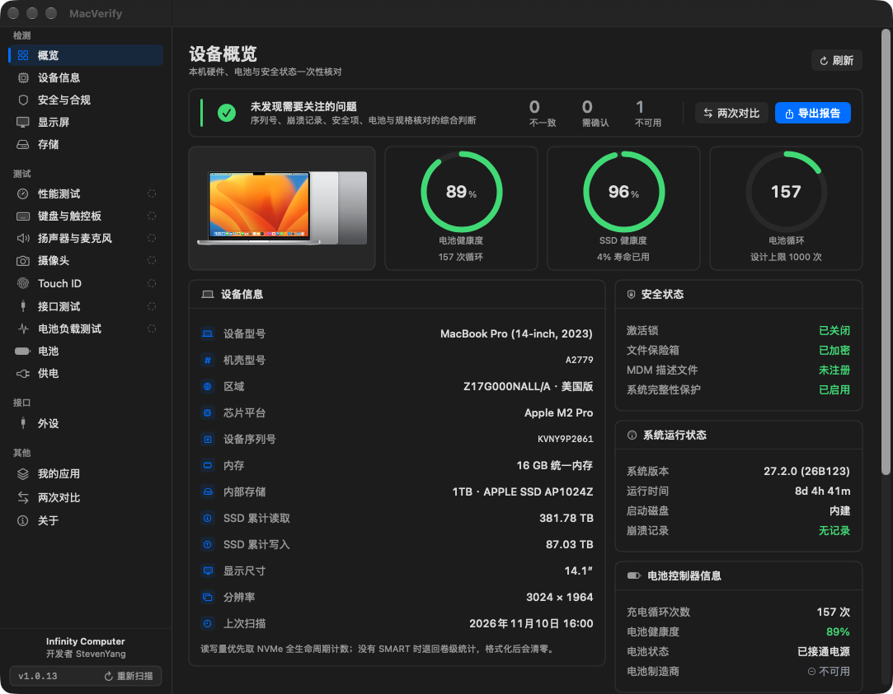
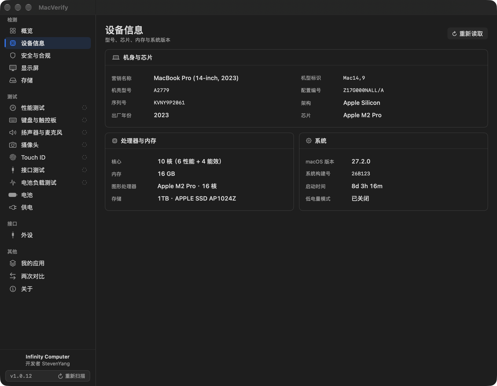
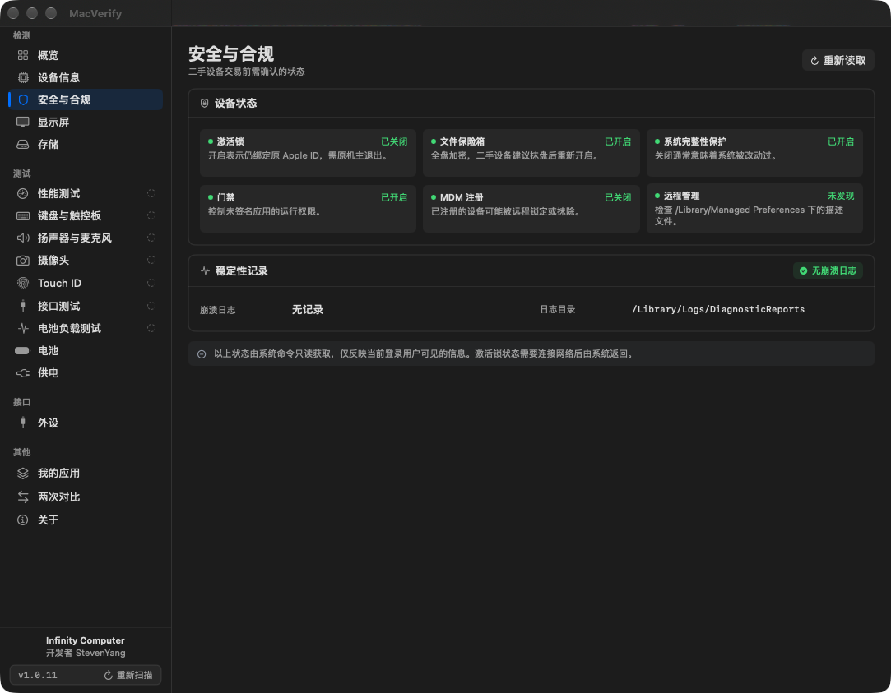
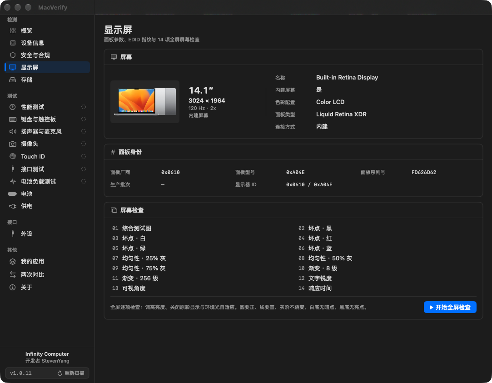
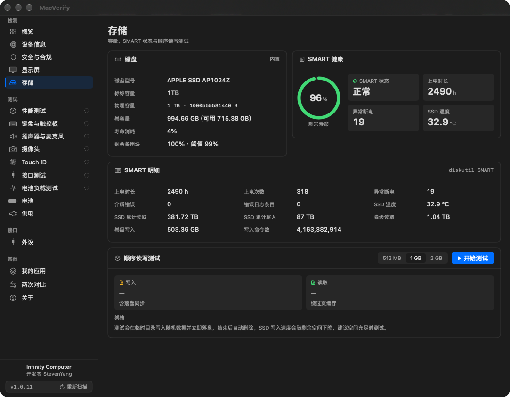
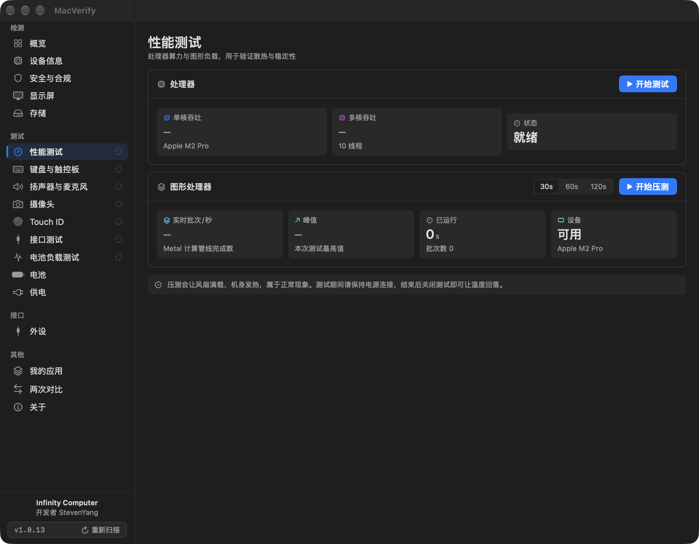
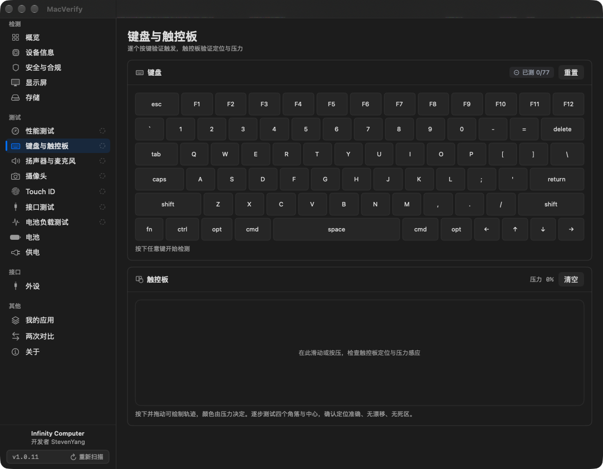
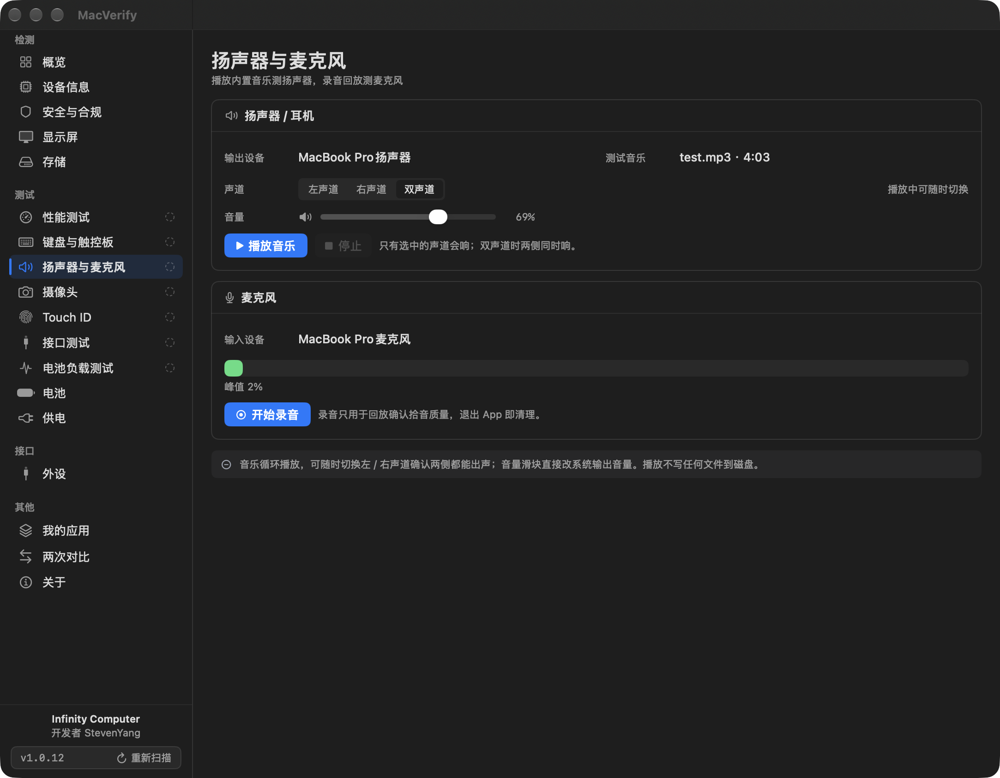
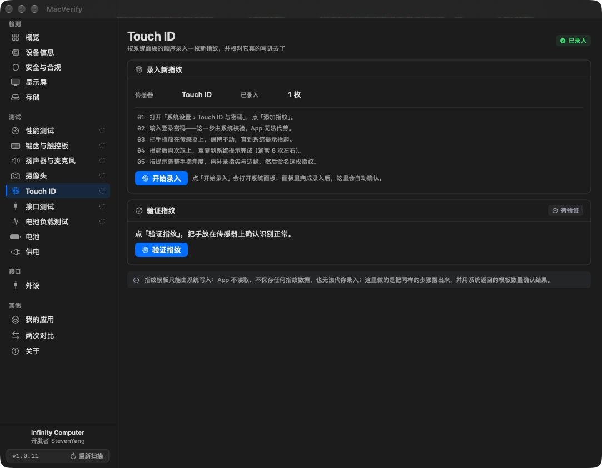

# MacVerify

**二手 Mac 硬件质检工具，所有数值都来自这台机器本身。**

[**English**](README.md) · macOS 12 Monterey 或更高 · 通用二进制（Intel 与 Apple Silicon）· 简体中文 / English



数据取自 IOKit、sysctl、CoreGraphics 与少量只读系统命令。有凭据才下结论，没有就如实写「不可用」——
不估算、不补值、不用 0 或 false 冒充。

## 为什么可信

| 做法 | 意味着什么 |
| --- | --- |
| **双通路互证** | 机型、序列号、芯片、磁盘容量、内建屏、内存各读两条独立通路，不一致就报告——这是识别改机型、刷序列号的唯一可靠破绽 |
| **缺失即不可用** | 读不到就输出 `null` / 「不可用」；确实不存在（没插设备、没有电池）用另一种标记，两者绝不混为一谈 |
| **不写死易错数据** | 机型表只收 Apple 官方标识符，不把芯片写进机型名；规格基线只覆盖已核对的官方技术规格页 |
| **可复核** | 报告导出为 Markdown + JSON，缺失项为 `null`；同一台机器两次检测可逐字段对比 |

## 功能

| 模块 | 内容 |
| --- | --- |
| 概览 | 机型、销售区域（配置编号后缀）、芯片、内存、容量、电池健康、激活锁、FileVault、MDM、崩溃记录 |
| 一致性核验 | 机型 / 序列号 / 芯片 / 磁盘容量 / 内建屏 / 内存 双通路比对 |
| 原装性核对 | 对照 Apple 技术规格：内建屏、内存与存储档位、GPU 核心数、电池容量与自洽 |
| 设备信息 | 架构、核心构成（Intel 核心/线程、Apple Silicon 性能核 + 能效核）、全部 GPU（含 Intel 独显） |
| 安全与合规 | 激活锁、FileVault、SIP、Gatekeeper、MDM、远程管理、内核崩溃（含 `.ips`） |
| 显示屏 | 原生分辨率、刷新率、面板身份；14 项全屏检查（坏点 / 均匀性 / 渐变 / 锐度 / 视角 / 响应时间） |
| 存储 | 磁盘型号、物理容量、NVMe SMART 全字段（寿命、备用块、上电时长、异常断电、温度、累计读写）、读写实测 |
| 性能测试 | CPU 单核 / 多核吞吐、Metal 持续负载（真实批次每秒），可多次运行对比 |
| 键盘与触控板 | 逐键点亮与覆盖统计、修饰键左右区分、触控板轨迹与压力 |
| 扬声器与麦克风 | 内置测试音乐循环播放，可切换左 / 右 / 双声道并直接调系统音量；麦克风电平、录音与回放 |
| 摄像头 | 实时预览与采集分辨率；录制 `.mov` 到桌面并页内回放 |
| Touch ID | 按系统面板顺序录入新指纹（记录 `bioutil` 模板数、实时确认写入），再真正调起一次识别 |
| 接口测试 | 逐口插入，IOKit 实时差分出接入 / 拔出事件与 USB 链路速率 |
| 电池 | 容量、健康度（与系统设置同口径）、循环、电压电流、内阻估算 |
| 电池负载测试 | 真实放电采样：容量一致性、压降、温升，结果可留档对比 |
| 供电 | 适配器功率、充电状态、实时功率、剩余时间 |
| 外设 | 当前连接设备与传输通道信息 |
| 两次对比 | 任意两次留档检测逐字段对比 |
| 我的应用 | 跳转到作者的其它应用发布页 |

## 界面

<table>
  <tr>
    <td width="50%"><br>
      <sub><b>设备信息</b> —— 核心、线程、全部 GPU，内存与存储在同一个视野里</sub></td>
    <td width="50%"><br>
      <sub><b>安全与合规</b> —— 激活锁、文件保险箱、SIP、Gatekeeper、MDM、远程管理</sub></td>
  </tr>
  <tr>
    <td><br>
      <sub><b>显示屏</b> —— 面板身份与 14 项全屏检查</sub></td>
    <td><br>
      <sub><b>存储</b> —— NVMe SMART 全字段，不靠一个「健康」糊过去</sub></td>
  </tr>
  <tr>
    <td><br>
      <sub><b>性能测试</b> —— CPU 与 Metal 持续负载，多次运行可对比</sub></td>
    <td><br>
      <sub><b>键盘与触控板</b> —— 真实键位图上的逐键覆盖</sub></td>
  </tr>
  <tr>
    <td><br>
      <sub><b>扬声器与麦克风</b> —— 声道扫频、电平表、录音与回放</sub></td>
    <td><br>
      <sub><b>Touch ID</b> —— 录入步骤配实时模板数，最后真正验证一次</sub></td>
  </tr>
</table>

## 系统要求

- macOS 12.0 Monterey 或更高；Intel 与 Apple Silicon 均可
- 无沙盒、无后台常驻、无内核扩展、无特权 helper

## 安装

1. 到 [Releases](https://github.com/stevenjx/MacVerify/releases) 下载最新 `.dmg`
2. 把 `MacVerify.app` 拖进「应用程序」
3. 首次打开如提示「无法验证开发者」：右键点击 → 打开（或
   `xattr -dr com.apple.quarantine /Applications/MacVerify.app`）

应用为 ad-hoc 签名，未做 Apple 公证。

DMG 是通用二进制（arm64 + x86_64），最低 macOS 12，Intel 与 Apple Silicon 都能打开。
如果提示 **「this application is not supported on this Mac」**，说明手上这份是单架构包——
`Scripts/build_local_app.sh` 默认只编译当前这台 Mac 的架构。请改用 DMG，或加 `--universal` 重新编译。

## 更新

启动时向 GitHub 查一次最新版本，6 小时内不重复。有新版本时侧栏左下角的版本号变琥珀色并多出一行提示，
点版本号即把该版本的官方 DMG 下载到「下载」文件夹并在访达中选中；不自动安装，也不覆盖已有文件。

## 数据来源

`IOKit`（AppleSmartBattery、IOPlatformExpertDevice、NVMe SMART、IOMedia）、`sysctl`、`CoreGraphics`，
以及只读命令 `system_profiler` / `diskutil` / `fdesetup` / `csrutil` / `spctl` / `profiles` / `bioutil`。
所有命令一律按 `-json` / `-plist` 解析，不受系统语言影响。

## 已知限制

- **传感器**：Apple Silicon 多数机型不向用户态提供电池温度与 SMC 电压，显示「不可用」，不估算。
- **SMART**：内置 SSD 可读完整 NVMe SMART；外接盘取决于桥接芯片是否转发。
- **电池容量核对**：Apple 公布 Wh、电池只报 mAh，换算需要额定电压；本机不提供时该项不做判断。
- **机型与规格基线**：只收 Apple 官方标识符与已核对的规格页；未收录机型显示「未收录 / 无对照数据」，不按前缀猜。
- **激活锁**：状态由系统返回，离线时可能读不到。

## 从源码构建

```bash
DEVELOPER_DIR=/Applications/Xcode.app/Contents/Developer xcodebuild \
  -project MacVerify.xcodeproj -scheme MacVerify -configuration Release \
  -destination 'generic/platform=macOS' -derivedDataPath build \
  ARCHS="arm64 x86_64" ONLY_ACTIVE_ARCH=NO CODE_SIGNING_ALLOWED=NO build
```

`Scripts/build_local_app.sh` 默认只编译本机架构；要拿到另一台机器（比如 Intel Mac）上跑，加 `--universal`。

自动化入口（测试与核验用）：

- `MACVERIFY_PAGE=<overview|hardware|security|display|storage|performance|input|audio|camera|touchID|ports|loadTest|battery|power|peripherals|apps|comparison|about>`
  直接打开指定页面
- `MACVERIFY_DUMP_REPORT=/tmp/report.md` 采集一次并导出 Markdown + JSON 后退出
- `MACVERIFY_PANEL_TEST=<0-13>` 进入全屏屏幕检查并停在第 N 项（`14` = 完成页）

## 发布流程

1. 改动提交并推送，**此时不发 release**
2. 本地可测试 App：`Scripts/build_local_app.sh` → `dist/local/MacVerify.app`
3. 只有 GitHub 上创建了 release 才产出 DMG：CI 监听 `release: published`，构建通用二进制、
   校验标签与版本号一致后上传为该 release 的附件
4. 本地留档：`Scripts/make_dmg.sh`（该版本未发布时直接退出）

版本号在 `project.pbxproj` 两处同步：`MARKETING_VERSION` / `CURRENT_PROJECT_VERSION`。

## 隐私

检测全程离线，不上传任何本机数据，不修改系统设置。唯一的外连是启动时的版本检查：只读公开的 release 元数据，
不携带序列号、机型等任何本机信息。录音与录像只在本机：录音写临时目录、退出即清理；录像只在点击录制时写入桌面。
检测数据仅保存在本机 `UserDefaults`。

## 开发与测试

```bash
swift test --disable-sandbox          # 114 个单元测试
python3 Scripts/check_baseline.py     # 机型表与规格基线自检
python3 Scripts/check_localization.py # 中英文案查漏
```

开发规划见 [docs/DEVELOPMENT_PLAN.md](docs/DEVELOPMENT_PLAN.md)，界面改造记录见 [docs/UI_PLAN.md](docs/UI_PLAN.md)。
